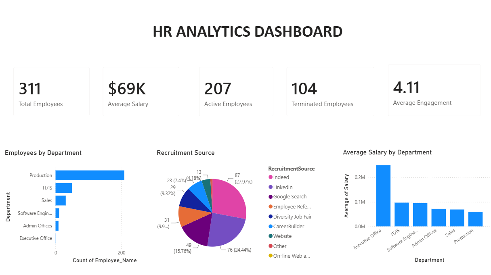
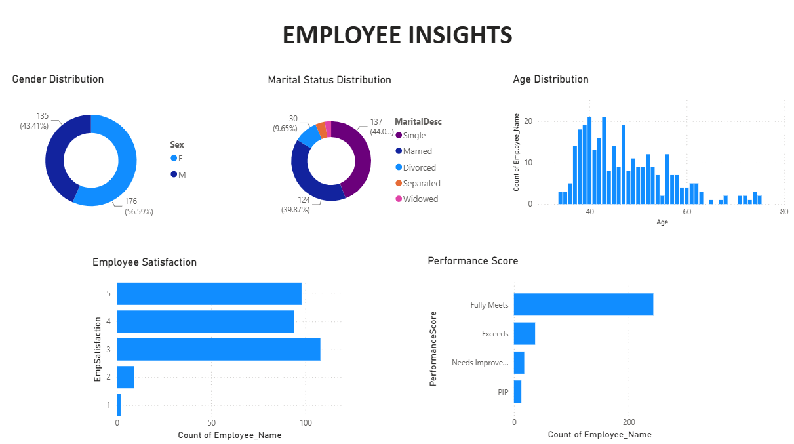
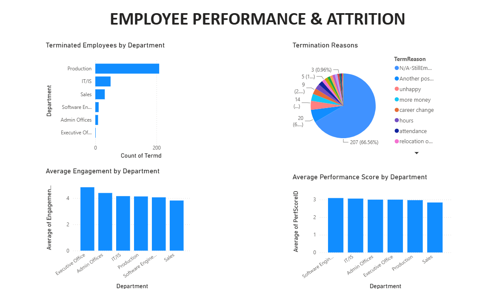

# 📊 HR Analytics Dashboard | Power BI

An interactive **HR Analytics Dashboard** built using **Power BI** to analyze employee demographics, salaries, recruitment, engagement, performance, and attrition.

---

## 📌 Project Overview

This dashboard provides HR teams and business leaders with key workforce insights through interactive visualizations. It helps analyze employee distribution, recruitment sources, salary trends, performance, engagement, and attrition across departments.

---

## 🛠️ Tools Used

- Power BI Desktop
- Microsoft Excel
- DAX
- Data Modeling
- Data Visualization

---

## 📈 Dashboard Pages

### 1️⃣ HR Analytics Dashboard

Provides a high-level overview of the organization with KPIs and department-wise insights.

**Key Metrics**
- Total Employees
- Average Salary
- Active Employees
- Terminated Employees
- Average Engagement

### Dashboard Preview



---

### 2️⃣ Employee Insights

Provides demographic and employee-related insights.

**Visualizations**
- Gender Distribution
- Marital Status Distribution
- Age Distribution
- Employee Satisfaction
- Performance Score

### Dashboard Preview



---

### 3️⃣ Employee Performance & Attrition

Analyzes employee exits and departmental performance.

**Visualizations**
- Terminated Employees by Department
- Termination Reasons
- Average Engagement by Department
- Average Performance Score by Department

### Dashboard Preview



---

## 📁 Repository Structure

```
HR-Analytics-Dashboard
│
├── Power BI
│   ├── HR_Analytics_Dashboard.pbix
│   └── HR_Analytics_Dashboard.pdf
│
├── Screenshots
│   ├── hr_analytics_dashboard.png
│   ├── employee_insights.png
│   └── employee_performance_attrition.png
│
└── README.md
```

---

## 💡 Key Insights

- Production department has the highest employee count.
- Average salary is approximately **$69K**.
- Most employees meet performance expectations.
- Recruitment primarily comes from a few major sources.
- Employee engagement varies across departments.
- Attrition is concentrated in specific departments.

---

## 📌 Conclusion

This project demonstrates how Power BI can be used to transform raw HR data into interactive dashboards that support workforce analysis and business decision-making.
